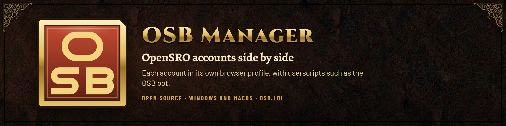

<p align="center"></p>

# OSB Manager

A Windows desktop app for running several OpenSRO accounts side by side, each with userscripts such as the OSB bot.

- Every account runs in its own browser profile. Cookies, local storage and the game's own cache are separate.
- The game's pack files are downloaded once and shared by every account.

OSB Manager is open source, by Corevider, and unofficial: it is not made or endorsed by the OpenSRO project. Guides and downloads are on [osb.lol](https://osb.lol). The bot it is built to run is [OSB](https://github.com/corevider/osb).

## Download

Get the latest release from [GitHub Releases](https://github.com/corevider/osb-manager/releases/latest), or follow the install guide at [osb.lol](https://osb.lol/en/install/).

- **Windows (x64):** `OSB-Manager-windows-x64.zip`. Unzip it anywhere and run `OsbManager.exe`. It is one self-contained file, so no .NET install is needed. It needs Windows 10 or 11 and the Microsoft Edge WebView2 Runtime (Windows 11 already has it).
- **Updates:** the app can update itself from signed releases, only after you click **Install and restart**. See [Updates](#updates).
- **Check the download:** `OSB-Manager-windows-x64.zip.sha256` holds the SHA-256 of the zip. In PowerShell, `(Get-FileHash .\OSB-Manager-windows-x64.zip).Hash` must match it, ignoring case.
- **macOS (Apple Silicon, macOS 26 or later):** `OSB-Manager-macos-arm64.zip`. Unzip it and move **OSB Manager** to Applications. It is signed with Corevider's Developer ID and notarised by Apple. `shasum -a 256 OSB-Manager-macos-arm64.zip` must match `OSB-Manager-macos-arm64.zip.sha256`.

## Requirements

- Windows 10 or 11.
- The Microsoft Edge WebView2 Runtime. Windows 11 already has it.
- The .NET 10 SDK, to build.

## Build and run

```powershell
dotnet build OsbManager.slnx -c Release
.\src\OsbManager\bin\Release\net10.0-windows\OsbManager.exe
```

### Install with a desktop shortcut

```powershell
.\scripts\install.ps1
```

- **What it does:** publishes the app to `%LOCALAPPDATA%\Programs\OSB Manager` and puts an **OSB Manager** shortcut on the desktop.
- **Updating:** run it again after a change. Close the installed app first: the script stops if the app is running from that folder.
- **Build files:** they go to `%TEMP%\OsbManager-install`, not to `bin\`. So a copy running from `bin\Release` does not block the install, and the installed copy does not block development builds.
- **Options:** `-Destination` changes the folder, `-ShortcutName` the shortcut name and `-ShortcutDirectory` the folder of the shortcut.
- **Data:** the installed copy and a development build use the same data folder, so accounts, scripts and settings carry over. Only one of them can run at a time.

Run the tests:

```powershell
dotnet test OsbManager.slnx
node --test tests/bridge/*.test.mjs
```

### Build the release package

```powershell
.\scripts\package-windows.ps1
.\scripts\test-package-windows.ps1
```

The first script publishes a self-contained single file for `win-x64` and writes `dist\OSB-Manager-windows-x64.zip` (the app, this README and the licence) with its `.sha256` file. The second unzips it into a temporary folder, starts it with a throwaway `--data` folder, opens **Help → About**, closes it and checks that no login was stored.

## Using it

1. **Add an account.** Click **+** and give the account a name. The name is shown only in this app.
2. **Add the bot.**
   - A new install puts OSB on the **Scripts** tab by itself, turned on, on Windows and macOS. An existing install is not changed. OSB then updates itself when a new version comes out. To stop this, untick **Scripts → Update OSB automatically**. Game windows that are open are not reloaded: the new version applies after a reload.
   - **Add from URL…** adds OSB again, or by hand. On the **Scripts** tab, click **Add from URL…**. The suggested address is the OSB bot: `https://raw.githubusercontent.com/corevider/osb/main/osb.user.js`.
   - Or click **Add file…** and pick a local `.user.js` file.
3. **Optional: save the game login.** On the **Account** tab, fill in **Login ID** and **Password**. You can also fill in **Server** and **Character**. Tick **Log in automatically**, then click **Save**. See [Automatic login](#automatic-login).
4. **Start the account.** Use **Start**, **Start light** or a double-click. Without automatic login, log in inside the game window yourself.
5. **Watch the account.** **Status** and **Stats** show every open account. They read what the bot reports through `window.SROLean`, which OSB and the previous bot both provide. **Status** also counts the scrolls in each character's bag: **Return** is every kind of return scroll (special ones included), **Reverse** the reverse return scrolls.

**Starting every account.** **Start all light**, at the bottom or under **Accounts**, starts every closed account in light mode. **Start all** starts them in normal mode. Either way they open one at a time, 15 seconds apart.

**The account menu.** Right-click an account (Control-click on macOS) to open a menu with Start, Close and the other actions. The same menu opens on the account's row in the **Status** tab.

**The start order.** The accounts open in the order of the list, top first. To change it, select an account and move it with:

- **▲** and **▼** at the bottom;
- **Accounts → Move up** and **Move down**;
- **Alt+Up** and **Alt+Down** in the list.

The order is saved, and **Status** and **Stats** use it too. Windows that are still waiting to open follow the new order.

**The All characters row.** In **Stats**, the accounts hunt at the same time, so this row shows:

- **Hunting:** the longest session, not the sum of all sessions;
- **per-hour columns (Kills/h, XP/h, Gold/h):** the sum of each account's own rate.

### SoX drops

The game announces every Star, Moon and Sun drop to the whole server, for example "hunter has dropped Demon Polearm (Seal Of Star) from Wing Tribe Chaser". The page bridge reads these announcements, and the **SoX** tab lists them for all accounts together: time, character, item, seal, monster, and which window saw it.

- **Where they come from:** Star and Moon drops arrive as chat lines. Sun drops arrive as the game's banner notice ("SEAL OF SUN: …"), which the bridge reads too. A drop seen both ways is kept once.

- **Duplicates:** every window sees the same announcement, so one seen again within two minutes is kept once.
- **Filter:** **Only my characters** hides other players' drops. Sun drops are shown in bold.
- **Storage:** the list is kept in `sox.json`, at most 1000 entries. **Clear list** empties it.
- **Stats:** the **SoX** column counts the drops of each character since the app started.
- **Log:** a drop by one of your characters is also written to the **Log**.

**The previous bot.** OSB replaces it, and two bots must not run together.

- **The notice.** When a saved script comes from the previous bot's repository, the **Scripts** tab shows a notice with two buttons:
  - **Replace with OSB** installs OSB from the address above and turns the previous bot's script off. That script stays installed, so you can turn it on again. If OSB cannot be installed, nothing changes.
  - **Keep** hides the notice for good. The choice is kept in `settings.json`.
- **The warning.** While OSB and the previous bot are both turned on, the tab shows a red warning and the Log says so.
- **No silent change.** The app never replaces or turns off a script without one of these buttons.

To change scripts, use **Update** or turn a script on or off. The change applies when a game window reloads: use **Reload** in its menu, or **Scripts → Reload open game windows**.

### Automatic login

With **Log in automatically** on, the page bridge goes through the game's own login screen as a player would. The game's on-screen controls have stable `data-ui-id` attributes, and the bridge uses them.

**What it does, in order**

1. Waits 8 seconds, so the game can first restore a login it still holds from its session cookie.
2. Clicks **Continue to login** (`frontend:reveal`).
3. Opens the server list (`native:servers`) and picks a server:
   - the one named in **Server**, matched by name or id;
   - with **Server** empty, the server the game already selected.

   Then it clicks **Select** (`native:server-accept`).
4. Asks the app for the login, then types it into **Account** and **Password** and clicks **Connect** (`login`).
5. On the character screen:
   - The game draws the characters in 3D, so there are no buttons to click.
   - The bridge finds **Character** in the roster the game's simulation worker sends. The match ignores case.
   - It enters the character with the same `enter-world` session command that the game's **Start** button sends.
   - It never enters a character that is waiting to be deleted.
   - If the name is not on the account, it stops and lists the account's characters.
   - With **Character** empty, it stops there so you can choose.

The bridge watches the simulation worker (`sro-simulation`) the same way the bots do, so this works with or without a bot. The log says "linked to the game" once it is attached.

**Limits and safety**

- **Two tries.** After two failed logins it stops and shows **Auto login stopped** in **Status**, with the reason in the **Log**. Saving the account again starts it over.
- **Rate limit.** The app gives a page the password at most 3 times in 10 minutes, and at least 15 seconds apart.
- **Where the password goes.** It is sent only when the page asks for it, and only while the window shows `https://opensro.online/`.
- **How it is stored.** It is encrypted with Windows DPAPI for the current Windows user. It is never written in plain text or to the log.
- **Another Windows user or PC.** There the password cannot be decrypted. Enter it again.
- **Resuming hunting.** To resume hunting after an automatic login (for example after a server restart), turn on the bot's **Start the bot when this character enters the game**.
- **The browser itself** does not save or fill in passwords. Its password and autofill features are turned off.

**When an account does not get into the game**

- **The game's own login.** If the game restores a login from its session cookie, the bridge enters the character without typing the saved login, so the Log has no "typing the saved login" line for that window. The Log says "in the game as …" whenever an account reaches the world, either way.
- **Settings sent again.** While the page reports that automatic login has not started, the app sends the account's login settings again every 15 seconds.
- **One reload.** If the account is still outside the world 3 minutes after the window started, and the page never reached the login form or the game stayed busy (for example at `authenticating`), the app reloads that window's page once and gives the new page another 3 minutes.
- **Not logged in.** After that, or after 3 minutes in any other case, **Status** says "Not logged in" with the reason, and the Log says it once: "auto login off", "no saved login", "auto login stopped", "choose a character", "the game stayed at authenticating", "login did not finish" or "login screen not found". The time counts from the window's start or from the moment the character left the world.

### Frame rate and CPU

- **Frame rate limit.** The game draws on every animation frame, which is the monitor's refresh rate. On a 200 Hz monitor that is 200 frames a second in every window. **View → Frame rate limit** caps this, and the default is **60 FPS**. Measured on the title screen at 200 Hz, one window used 134% of one core without the limit and 58% with 60 FPS. A change applies to open windows at once.
- **Minimised windows.** A minimised game window hides its page, so the game switches to its hidden-tab path and stops drawing. Timers are not throttled, so the game and the bot keep running. On the title screen this took the window to 0% CPU.
- **What is left.** Most of the remaining CPU is the game's own work, about one core per account inside the game world. That part is the same in Brave or Chrome.

### Light mode

**Light mode** stops the game's drawing and mutes the window. The game and the bot keep running.

**When it starts.** The game finishes loading a world only while it draws, so light mode waits until the account is in the game. Until then the **Status** tab shows "(light after loading)". Light mode starts when all of these hold:

- the game has reported that the world finished loading (the `world-ready` message it sends its simulation worker);
- the bot has started hunting, or 15 seconds have passed.

A new loading screen, such as a teleport or a reconnect, turns drawing back on until that world has loaded too. Light mode only acts when its own decision changes, so the bot's **No Render** button can still be used by hand.

**Memory.** While light mode is on, the window's WebView2 memory target is low, so the page drops its caches and Windows can trim it. On the title screen this cut the page's working set from about 860 MB to about 290 MB. Its private memory went from 760 MB to 550 MB. The game's GPU memory stays, because the game keeps its GPU device so that drawing can resume without a reload. Use light mode for every account you do not watch.

- With OSB or the previous bot loaded, the app uses the bot's own **No Render** switch. That switch uses the client's hidden-tab render path.
- Without a bot, the app does the same thing itself.

### Memory tab and memory settings

The **Memory** tab shows, for every open account, the game renderer's private memory and working set, the JS heap and any WebAssembly memory, and below the table the GPU process, all browser processes and the app. It refreshes only while it is visible. **Copy memory report** copies the same numbers as plain text. **View** has one memory setting, off by default: **Low memory when a window is minimised**. How the numbers are read, what the setting does and the measurements behind the default are in [docs/manager-memory.md](docs/manager-memory.md).

### Graphics memory and starting several accounts

Each game window keeps a WebGPU device on the graphics card, about 0.8 GB per window measured with six windows. Light mode and minimising do not free it.

**When the card is full.** If it is full when a window starts its renderer, creating the device fails with an error like `Renderer failed: OperationError: Failed to execute 'requestDevice' on 'GPUAdapter': ID3D12Device::CreateDescriptorHeap ... CheckOutOfMemory`. The game does not try again. All accounts share one GPU process, so this is about the whole card at that moment, not about the one window. A window starts its renderer again whenever its page loads: when it opens, on **Reload**, and when the bot reloads the page after a failed load or an expired session. The app helps in these ways:

- **One renderer start at a time.** Before the game creates its device, the page asks the app for a turn. Only one window starts its renderer at a time, 2 seconds apart. A window that does not hand its turn back within 20 seconds, closes or reloads loses it at once. If the app does not answer within 120 seconds, the page goes ahead anyway.
- **Retry.** The page requests the device again up to six times, 4, 8, 15, 30, 60 and 120 seconds apart, each time with a fresh adapter. The **Status** tab shows "Renderer failed, retrying in 60 s" and the **Log** lists each try.
- **Reload, then restart.** If all tries fail, the app reloads the page once. If that fails too, it closes the window and opens it again with the same profile and saved login ("Restarted after renderer failure"). If the renderer still cannot start, the row says "Renderer failed, use Reload". **View → Restart a window when its renderer cannot start** turns the restart off; it is on by default. Reaching the game world starts these steps over.
- **After a recovery** the window logs in again with its saved login, as after any reload. The bot resumes hunting through its own auto-start, so turn that on for accounts that should continue by themselves.
- **Start one at a time.** Accounts started together, with **Start** several times or with `--start`, open one at a time, 15 seconds apart. While an account waits, its row says "Starts in N s".

### A window that stops responding

Every account has its own page process, so a page that hangs or crashes affects only its own window. The app never closes or restarts other windows because of it. Closing every window is always the player's own **Close all** or quitting the app.

- **Wait.** When the browser reports the page as not responding, the Log says so and **Status** shows "Not responding for N s, waiting". A page that sends its status again within 60 seconds is left alone, and the Log says "the page responds again".
- **Reload that window.** After 60 seconds without a status from the page, or at once when the page process has ended ("Page crashed, reloading"), the app reloads that window's page.
- **Restart that window.** If the page still sends nothing for 90 seconds, the app closes that window and opens it again with the same profile and saved login, through the start queue.
- **Give up.** If that does not help within another 90 seconds, the row says "Not responding, use Reload".
- A page that is still loading and has never sent a status is not reloaded for being quiet. Reaching the game world starts these steps over.

## How it works

| Part | What it does |
| --- | --- |
| One WebView2 environment | The browser, GPU and network processes are shared. Each account is a separate WebView2 profile named `acc-<id>`, so its data is isolated. |
| Background throttling off | The environment starts with `--disable-background-timer-throttling --disable-renderer-backgrounding --disable-backgrounding-occluded-windows` and with `CalculateNativeWinOcclusion` and `IntensiveWakeUpThrottling` disabled. Covered or minimised windows keep full timer speed, so bots do not slow down. |
| Shared asset cache | See below. |
| Userscripts | Tampermonkey-style scripts run through `AddScriptToExecuteOnDocumentCreated`, before any page script. The wrapper applies `@match`, `@include`, `@exclude`, `@run-at` and `@noframes`. |
| Page bridge (`bridge.js`, `autologin.js`, `light.js`, `gpu.js`, `drops.js`) | Once a second it posts the bot's status to the app with `chrome.webview.postMessage`. It also limits the frame rate, carries the light mode switch, retries the WebGPU device and runs the automatic login. The app treats these messages as untrusted: it accepts them only from `https://opensro.online/`, limits their size, and bounds every field. |

**Shared asset cache**

- The game loads `/assets/packs/*.bin` with HTTP `Range` requests, from a worker. Every pack name ends in the first 12 hex digits of its SHA-256, and the server marks packs `immutable`.
- The app catches these requests with `WebResourceRequested` and answers them with `206 Partial Content` from `%LOCALAPPDATA%\OSB Manager\cache\packs`.
- A range that is not stored yet is downloaded once (identical requests share one download), saved and served.
- Each pack is a sparse file plus an index of the ranges stored. The index is written only after the data has been flushed, so a crash never lists bytes that are missing.
- When a pack is complete, the app hashes it. If the hash does not match the pack's name, the pack is deleted.
- Any request the cache cannot answer is left to the browser, which loads it from the network as usual.
- The game also verifies the SHA-256 of every asset it reads.

### Supported userscript features

- `@grant none`, `unsafeWindow`, `GM_info`, `GM_addStyle`, and `GM_getValue` / `GM_setValue` / `GM_deleteValue` / `GM_listValues`, plus their `GM.*` forms. Values are stored in the page's local storage, separately for each account.
- `@grant GM_xmlhttpRequest`, other grants and `@require` are not supported. The **Scripts** tab lists them under **Notes**.

## Data folder

`%LOCALAPPDATA%\OSB Manager` (**File → Open data folder**):

| Path | Contents |
| --- | --- |
| `sox.json` | The SoX drop announcements, newest 1000. |
| `accounts.json` | Account names, login IDs, DPAPI-encrypted passwords, server and character choices, the light mode default, window positions. |
| `WebView2\` | The browser profiles, one per account (cookies, storage, the game's own cache). |
| `cache\packs\` | The shared game packs. **File → Clear shared asset cache…** deletes them. |
| `scripts\` | Installed userscripts and `scripts.json`. |
| `logs\` | A daily log file. |
| `privacy.json` | Your answer about usage statistics and, only when you said yes, the random install ID and its key (protected for your Windows user). See [Privacy](#privacy-and-usage-statistics). |
| `outbox\` | Problem reports that could not be sent yet. At most 5. |
| `updates\` | A downloaded update while it is checked and installed. Deleted afterwards and at the next start. |

Removing an account deletes its browser profile as well.

## Command line

```
OsbManager.exe [--data <folder>] [--start <account>[,<account>...]] [--light] [--debug-port <port>]
```

| Option | What it does |
| --- | --- |
| `--data` | Uses another data folder, for example for tests. Only one instance can run per data folder. |
| `--start` | Opens these accounts at startup, and creates any that do not exist. |
| `--light` | Starts them in light mode. |
| `--debug-port` | Turns on the Chromium remote debugging port, for diagnostics only. Never use it with real accounts on a shared machine. |

## Updates

OSB Manager can update itself from the [GitHub releases](https://github.com/corevider/osb-manager/releases), but only when you say so and only with a release signed by Corevider.

- **When it checks.** About two minutes after it starts, then every six hours. It waits while a game window is starting. **Help → Check for updates now** checks at once.
- **The switch.** **Help → Check for updates** is on by default. Turned off, the app makes no update request at all. **Check for updates now** still works, because you asked for it.
- **What it contacts.** Only GitHub, over HTTPS: `api.github.com` (which release is the latest), `github.com` (the release files) and the download host GitHub redirects to (`release-assets.githubusercontent.com`, or `objects.githubusercontent.com`). Any other host, any redirect elsewhere and plain HTTP are refused.
- **What it sends.** Plain downloads with the User-Agent `OSBManager/<version> (Windows)`. No cookies, no login, no install ID and no other data about you or your accounts. Every request has a time limit and a size limit.
- **Nothing silent.** When a newer signed release exists, a notice at the top of the main window shows its title with **Install and restart**, **Later** and **Release notes**. **Later** hides it until the next start.
- **How a release is trusted.** Each release has a small manifest per platform (`OSB-Manager-windows-x64.update.json`: version, file name, size and SHA-256 of the zip) and its signature (`.update.json.sig`, ECDSA P-256), made with a release key only the maintainer holds. The app installs only when:
  - the signature verifies with a public key built into the app;
  - the signed version is newer than the running one (never older, never the same);
  - the downloaded zip has exactly the signed size and SHA-256.

  The `.sha256` files are for people checking a download by hand; the app never trusts them on their own.
- **Installing on Windows.**
  1. Downloads the zip into `updates\` in the data folder and checks it.
  2. Takes `OsbManager.exe` out of it and puts it next to the running one as `OsbManager.new.exe`. A failure up to here changes nothing.
  3. Closes the game windows (it asks first if a character is in the game), renames the running `OsbManager.exe` to `OsbManager.prev.exe` and puts the new one in its place.
  4. Starts the new version with the same options (`--data` and the others). If it does not start within 30 seconds, the previous exe is put back and the app keeps running.
  5. The new version deletes `OsbManager.prev.exe` when it starts.

  This works wherever the app lives, for example `%LOCALAPPDATA%\Programs\OSB Manager`, as long as Windows lets you write to that folder. If not, the app says so and offers the release page. Accounts, scripts and settings are in the data folder and stay as they are.
- **macOS.** The same checks and notice, with **OSB Manager → Check for Updates Now…** and **Check for Updates**. Before it replaces the app it also requires a valid `codesign --verify --deep --strict`, Gatekeeper's approval, Corevider's team ID and the app's bundle identifier. The new app is put next to the old one and swapped in, so saved Keychain logins keep working. See [docs/macos/README.md](docs/macos/README.md#updates).

## Privacy and usage statistics

**OSB Manager sends nothing to the OSB team unless you say yes.** Until you do, it makes no request to `osb.lol` at all: no sign-up, no ping, no statistics. The choice is in **Help → Privacy…**, and a short question in the main window when you first start the app (**Share** or **No thanks**; **What is sent?** opens the details). You can change your mind at any time. The text is in English or Turkish, following the Windows display language.

**If you share usage statistics** (pseudonymous: linked to a random install ID), about every 10 minutes the app sends one small status report: the app and bot version, Windows, your language and, for each open game window, the bot state (hunting, town trip, dead, login and so on), level, gold, HP and MP percentage, scroll counts, and the current session's kills, deaths, XP, gold and SoX drops. It is linked to a random install ID, not to your game login, password, e-mail or computer. Accounts are told apart by a one-way code, so account names are never sent. **Help → Privacy… → Show what is sent** shows the exact next report.

**Character names** are a second, separate choice, **Show my characters in the OSB dashboard**. Without it, no character or server name is sent.

**Problem reports** are sent only when you press **Send** in **Help → Report a problem…**. The window shows exactly what will be sent, including the technical details (versions, the state of each game window, the installed script names) and the screenshot of a game window if you add one, and asks you to confirm. You do not need to share usage statistics to send a report; without them the report is anonymous and you get a report code. A report that cannot be sent is kept in `outbox\` and retried for up to 72 hours (**Help → Unsent reports…**).

**Never sent:** login IDs, passwords, account names, positions, chat, item names, file paths, the computer's name or any hardware ID.

**Delete or download your data.** Turning the first switch off deletes your data on the server, wipes the local ID and key and removes the reports that were waiting to be sent. **Delete my data** does the same on request, and **Download my data** saves everything the server holds about this install. If the server cannot be reached, the window shows the install ID so you can ask for deletion at privacy@osb.lol. Statistics are kept for at most 90 days; the policy is at <https://osb.lol/privacy>.

**OSB Manager for macOS** follows the same rules, with the same wording (consent text version `2026-11-04.1`), and shows Turkish when the first preferred language is Turkish. The choices are in **OSB Manager → Privacy…** and **OSB Manager → Report a problem…**, and the first-run question is a panel in the main window. The install key is a generic password in the login Keychain (`com.corevider.osb-manager.install-key`) and `privacy.json` and `outbox/` are in `~/Library/Application Support/OSB Manager/`. The details are in [docs/macos/telemetry.md](docs/macos/telemetry.md).

**How it stays out of the way.** The code that sends runs in the background, on its own threads, one request at a time, with a 15 second limit. It never runs inside a game window or on the window thread. If the server is slow or down, the app does nothing different. The server can only switch the feature off or slow it down; it cannot make the app send more or run anything. The details are in [docs/telemetry.md](docs/telemetry.md).

## Known limits

- The game also keeps its own verified asset cache (Cache Storage `sro-next-verified-v1`) inside each profile, so each account still uses some disk of its own. The shared cache saves the downloads.
- Old packs from earlier game versions stay in the shared cache until you clear it.
- Status and stats depend on the bot's `window.SROLean` object. Without a bot, the app shows only the page state.

## macOS

There is also a macOS version of **OSB Manager**, a native Swift app with the game in CEF (Chromium) (Apple Silicon, macOS 26 or later). It is built and installed on a Mac from this repository, over SSH, with one command in Git Bash:

```sh
sh macos/scripts/install.sh
```

It installs `~/Applications/OSB Manager.app` and a link named "OSB Manager" on the Desktop, and the same command updates it. The first run downloads and verifies CEF on the Mac. Its data folder is `~/Library/Application Support/OSB Manager/`. See [docs/macos/README.md](docs/macos/README.md) for the options, the data folder, uninstalling, signing and what differs from this app.

**Release build.** The release zip is signed with Corevider's Developer ID and notarised by Apple ([docs/macos/RELEASE.md](docs/macos/RELEASE.md)). A build you make yourself from this repository is signed ad hoc: macOS shows a Gatekeeper warning for a downloaded copy (right-click, **Open**), and the Keychain asks for each saved password again after an update.

## Contributing and security

Pull requests and issues are welcome. CI builds and tests every pull request; a Claude review and an automatic fix attempt run for maintainers' items and, after a maintainer adds a label, for everyone else's. Nothing is merged without a maintainer's approval. Report security problems privately as [SECURITY.md](SECURITY.md) describes. Maintainers: see [docs/MAINTAINING.md](docs/MAINTAINING.md).

## Credits

- OSB Manager runs the OSB bot. Credits and license: see the [OSB README](https://github.com/corevider/osb#credits-and-license).
- The Windows app uses Microsoft Edge WebView2. The macOS app uses the Chromium Embedded Framework.

## License

GPL-3.0. Copyright Corevider. See [LICENSE](LICENSE).
